# ACA – Programación Avanzada

# Sistema de Gestión de Biblioteca

---

## PORTADA

**Ingeniería de Sistemas – Programación Avanzada**

### ACA – Programación Avanzada

### Sistema de Gestión de Biblioteca

**Presentado por:**  
Hernan Jose Vasquez Araujo 
Juan Camilo Rodriguez Caro
Maria Gabriela Julio Vasquez
Sara Liney Garcia Camargo

**Docente:**  
Veronica Castro

**Fecha:**  
Barranquilla, 7 de noviembre de 2026

---

# CONTRAPORTADA

**Sistema de Gestión de Biblioteca**

Proyecto desarrollado como evidencia del curso de **Programación Avanzada**, aplicando Programación Orientada a Objetos, base de datos relacional, arquitectura por capas, operaciones CRUD, validaciones, manejo de excepciones y conexión con SQL Server.

**Estudiantes:** Hernan Jose Vasquez Araujo, Juan Camilo Rodriguez Caro, Maria Gabriela Julio Vasquez, Sara Liney Garcia Camargo
**Programa:** Ingeniería de Sistemas – Programación Avanzada  
**Grupo:**   544469, 54467, 54463
**Docente:** Veronica Castro  
**Institución:** Corporación Universitaria Nacional de Educación Superior  
**Año:** 2026

---

# TABLA DE CONTENIDO


1. [Introducción](#1-introducción)
2. [Objetivos](#2-objetivos)
   - 2.1 Objetivo general
   - 2.2 Objetivos específicos
3. [Planteamiento del problema](#3-planteamiento-del-problema)
4. [Análisis de requerimientos](#4-análisis-de-requerimientos)
5. [Casos de uso](#5-casos-de-uso)
6. [Diagrama de clases](#6-diagrama-de-clases)
7. [Modelo entidad-relación](#7-modelo-entidad-relación)
8. [Diccionario de datos](#8-diccionario-de-datos)
9. [Arquitectura del sistema](#9-arquitectura-del-sistema)
   - 9.7 Descripción de la conexión con SQL Server
10. [Explicación de los módulos desarrollados](#10-explicación-de-cada-módulo-desarrollado)
11. [Capturas de pantalla del sistema](#11-capturas-de-pantalla-del-sistema)
12. [Pruebas de funcionamiento](#12-pruebas-de-funcionamiento)
13. [Conclusiones](#13-conclusiones)
14. [Recomendaciones](#14-recomendaciones)
15. [Referencias bibliográficas](#15-referencias-bibliográficas)
16. [Anexos](#anexos)

---

# 1. INTRODUCCIÓN

El presente documento describe el desarrollo del **Sistema de Gestión de Biblioteca**, una aplicación de escritorio cuyo propósito es facilitar la administración de los procesos de una biblioteca institucional: el inventario de libros, su organización por autores, editoriales e ISBN, la gestión de usuarios y el control de préstamos y devoluciones.

El sistema fue desarrollado con **C#, .NET 10, Windows Forms y SQL Server**, aplicando los principios de Programación Orientada a Objetos y una **arquitectura por capas** (Presentación, Lógica de negocio, Acceso a datos y Base de datos). El acceso a la base de datos se realiza mediante ADO.NET (`Microsoft.Data.SqlClient`) con **consultas parametrizadas**, y las operaciones que afectan el inventario se ejecutan dentro de **transacciones** para garantizar la integridad de la información.

La aplicación permite gestionar **libros, autores, editoriales, usuarios, préstamos y devoluciones**, además de consultar información consolidada mediante un **módulo de reportes** con exportación a CSV. Cuenta con un formulario principal desde el cual se navega entre los módulos de Inicio, Libros, Usuarios, Autores, Editoriales, Préstamos y Reportes.

---

# 2. OBJETIVOS

## 2.1 Objetivo general

Desarrollar un Sistema de Gestión de Biblioteca que permita administrar libros, autores, editoriales y usuarios, gestionar préstamos y devoluciones y generar reportes, utilizando Programación Orientada a Objetos, una base de datos relacional en SQL Server y una arquitectura por capas.

## 2.2 Objetivos específicos

- Diseñar e implementar una aplicación de escritorio en C# y Windows Forms para la gestión de libros, autores, editoriales, usuarios y préstamos.
- Aplicar principios de Programación Orientada a Objetos (clases, constructores, encapsulamiento, herencia y polimorfismo).
- Diseñar e implementar una base de datos relacional en SQL Server con claves primarias, foráneas y restricciones de integridad.
- Implementar operaciones CRUD para las entidades principales.
- Implementar validaciones de los datos ingresados por el usuario.
- Implementar manejo de excepciones con mensajes claros.
- Aplicar una arquitectura por capas que separe presentación, lógica de negocio y acceso a datos.
- Implementar reportes que faciliten la administración de la biblioteca.
- Utilizar Git y GitHub para el control de versiones.
- Documentar técnica y funcionalmente el proyecto.

---

# 3. PLANTEAMIENTO DEL PROBLEMA

## 3.1 Descripción del problema

La biblioteca de una institución educativa necesita administrar de manera organizada la información de sus libros, autores, editoriales y usuarios, así como controlar los préstamos y devoluciones. El manejo manual de esta información (hojas de cálculo o registros en papel) puede generar errores, registros duplicados, pérdida de información y dificultades para saber qué libros están disponibles o quién los tiene prestados.

Por esta razón se desarrolló una aplicación que centraliza la información en una base de datos relacional, valida los datos ingresados y mantiene la coherencia entre los préstamos y las existencias de cada libro.

## 3.2 Justificación

El sistema aporta los siguientes beneficios:

- **Centralización:** toda la información bibliográfica y de usuarios se almacena en una única base de datos.
- **Integridad:** las claves foráneas, las restricciones de unicidad y las validaciones evitan registros duplicados o inconsistentes.
- **Control del inventario:** el sistema descuenta y reintegra existencias automáticamente al prestar o devolver.
- **Trazabilidad:** permite consultar el estado de los préstamos y el historial de cada usuario.
- **Toma de decisiones:** los reportes muestran información consolidada, como los libros más prestados o los préstamos activos.

## 3.3 Alcance

El sistema permite:

- Gestionar libros (registrar, consultar, editar, eliminar y buscar por ISBN, título o autor).
- Gestionar autores.
- Gestionar editoriales.
- Gestionar usuarios.
- Registrar, consultar, editar y eliminar préstamos.
- Registrar devoluciones.
- Consultar la disponibilidad (existencias) de los libros.
- Consultar el estado de los préstamos (Prestado / Devuelto) y el historial por usuario.
- Generar 11 reportes y exportarlos a CSV.

### Fuera del alcance

- Autenticación de usuarios y manejo de roles o permisos del sistema.
- Cálculo de multas o sanciones por retraso en la devolución.
- Préstamos de varios libros en una misma transacción (no existe tabla de detalle de préstamos; cada préstamo corresponde a un libro).
- Libros con varios autores o con categorías administradas como entidad independiente (la categoría es un atributo del libro).
- Generación de reportes en PDF o impresión directa (los reportes se exportan a CSV).

---

# 4. ANÁLISIS DE REQUERIMIENTOS

## 4.1 Descripción general

El Sistema de Gestión de Biblioteca permite administrar la información de **libros, autores, editoriales, usuarios y préstamos**, y controlar los procesos de **préstamo, devolución y consulta** garantizando la integridad de los datos.

## 4.2 Actores del sistema

| Actor | Descripción |
|---|---|
| Bibliotecario / Administrador | Único actor que interactúa con el sistema. Registra y mantiene la información de libros, autores, editoriales y usuarios; registra préstamos y devoluciones; y consulta los reportes. |

## 4.3 Requerimientos funcionales

| Código | Requerimiento | Descripción |
|---|---|---|
| RF01 | Gestionar libros | Registrar, consultar, editar y eliminar libros; relacionarlos con su autor y editorial; buscar por ISBN, título o autor; consultar existencias. |
| RF02 | Gestionar autores | Registrar, consultar, editar y eliminar autores (si no tienen libros asociados). |
| RF03 | Gestionar editoriales | Registrar, consultar, editar y eliminar editoriales (si no tienen libros asociados). |
| RF04 | Gestionar usuarios | Registrar, consultar, editar y eliminar usuarios (si no tienen préstamos asociados). |
| RF05 | Gestionar préstamos | Registrar préstamos asociando un usuario con un libro, con su fecha; consultar, editar y eliminar préstamos; filtrar por estado. |
| RF06 | Gestionar devoluciones | Registrar la devolución de un préstamo: actualiza la fecha de devolución, el estado a «Devuelto» y las existencias del libro. |
| RF07 | Consultas y reportes | Generar reportes: resumen consolidado, listado de libros, libros disponibles, libros más prestados, autores, editoriales, usuarios, relación de préstamos, préstamos activos, préstamos devueltos e historial por usuario; exportar a CSV. |
| RF08 | Navegación del sistema | Formulario principal con acceso a Inicio, Libros, Usuarios, Autores, Editoriales, Préstamos y Reportes. |

## 4.4 Requerimientos no funcionales

| Código | Requerimiento | Descripción |
|---|---|---|
| RNF01 | Usabilidad | Interfaz clara, organizada y de uso sencillo, con formularios homogéneos entre módulos. |
| RNF02 | Validación | Se validan campos obligatorios, longitudes, formatos (correo, teléfono, documento, ISBN) y rangos (año, existencias, fechas). |
| RNF03 | Mantenibilidad | Código organizado por capas y carpetas, con nombres descriptivos. |
| RNF04 | Arquitectura | Arquitectura por capas: Presentación, Negocio, Datos y Base de datos. |
| RNF05 | Manejo de excepciones | Las operaciones capturan los errores y muestran mensajes claros; las reglas de negocio se informan con una excepción propia (`ReglaNegocioException`). |
| RNF06 | Integridad de datos | Claves primarias y foráneas, restricciones UNIQUE y CHECK, y transacciones en las operaciones de préstamo. |
| RNF07 | Consultas parametrizadas | Todas las consultas SQL usan parámetros, sin concatenar valores del usuario. |
| RNF08 | Separación de responsabilidades | Los formularios no contienen SQL; el acceso a datos está aislado en los repositorios. |

## 4.5 Reglas de negocio

| Código | Regla |
|---|---|
| RN01 | No se permiten dos libros con el mismo ISBN. |
| RN02 | No se permite guardar registros con campos obligatorios vacíos ni que superen la longitud definida en la base de datos. |
| RN03 | No se permiten usuarios con documento repetido. |
| RN04 | No se permiten autores con el mismo nombre y apellido, ni editoriales con el mismo nombre. |
| RN05 | Solo se registra un préstamo si el usuario y el libro existen. |
| RN06 | No se puede prestar un libro sin existencias disponibles. |
| RN07 | Al registrar un préstamo se descuenta una existencia del libro; al registrar la devolución se reintegra. |
| RN08 | Un usuario no puede tener prestado el mismo libro dos veces a la vez. |
| RN09 | La fecha de préstamo no puede ser posterior a hoy; la de devolución no puede ser anterior al préstamo ni posterior a hoy. |
| RN10 | Un préstamo «Prestado» no tiene fecha de devolución; uno «Devuelto» sí la tiene. |
| RN11 | Solo se pueden editar los préstamos en estado «Prestado». Si se cambia el libro, se reintegra la existencia del anterior y se descuenta la del nuevo. |
| RN12 | Al eliminar un préstamo activo, la existencia vuelve al inventario. |
| RN13 | No se puede eliminar un autor o editorial con libros, un usuario con préstamos, ni un libro con préstamos. |
| RN14 | El año del libro debe estar entre 1 y el año actual; las existencias no pueden ser negativas. |

---

# 5. CASOS DE USO

## 5.1 Descripción

El Bibliotecario / Administrador es el único actor. Interactúa con el sistema para mantener los datos maestros (libros, autores, editoriales y usuarios), gestionar el ciclo de préstamo y devolución, y consultar reportes.

## 5.2 Diagrama de casos de uso

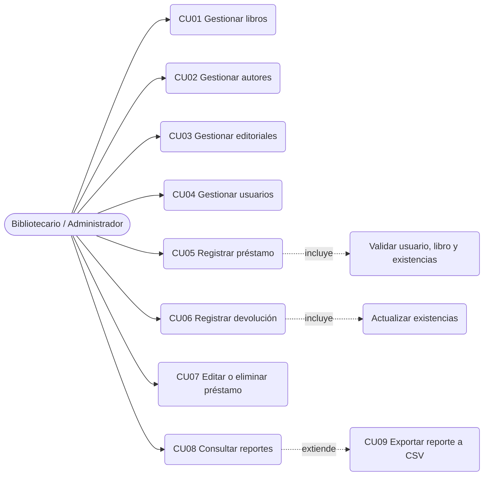

## 5.3 Descripción de casos de uso

### CU01 – Gestionar libros

**Actor principal:** Bibliotecario / Administrador

**Descripción:** Permite registrar, consultar, editar, eliminar y buscar libros, asociándolos a un autor y una editorial.

**Precondiciones:**
- La aplicación está conectada a la base de datos.
- Existen autores y editoriales registrados.

**Flujo principal:**
1. El actor ingresa al módulo **Libros**.
2. El sistema muestra los libros registrados (con autor, editorial y existencias).
3. El actor diligencia el formulario (ISBN, título, autor, editorial, categoría, año, existencias) y pulsa **Guardar**; o selecciona un libro y pulsa **Editar** o **Eliminar**; o escribe un texto y pulsa **Buscar**.
4. El sistema valida los datos y ejecuta la operación.
5. El sistema muestra un mensaje de confirmación y actualiza la tabla.

**Flujos alternativos:**
- Campos vacíos o inválidos: el sistema muestra el mensaje correspondiente y no guarda.
- ISBN repetido: el sistema informa «Ya existe un libro con ese ISBN».
- Libro con préstamos: el sistema impide eliminarlo e informa cuántos préstamos tiene.

**Postcondiciones:** el libro queda registrado, actualizado o eliminado, y la tabla refleja el cambio.

---

### CU02 – Gestionar autores / CU03 – Gestionar editoriales / CU04 – Gestionar usuarios

**Actor principal:** Bibliotecario / Administrador

**Descripción:** Permiten registrar, consultar, editar y eliminar autores, editoriales y usuarios respectivamente.

**Flujo principal:**
1. El actor ingresa al módulo correspondiente.
2. El sistema muestra los registros existentes.
3. El actor diligencia el formulario y pulsa **Guardar**, o selecciona un registro y pulsa **Editar** o **Eliminar**.
4. El sistema valida y ejecuta la operación, y muestra la confirmación.

**Flujos alternativos:**
- Registro duplicado (autor con mismo nombre y apellido, editorial con mismo nombre, usuario con mismo documento).
- Correo o teléfono con formato inválido (usuarios).
- Eliminación de un registro relacionado: el sistema la impide e indica la cantidad de registros asociados.

**Postcondiciones:** los datos maestros quedan actualizados.

---

### CU05 – Registrar préstamo

**Actor principal:** Bibliotecario / Administrador

**Descripción:** Permite registrar el préstamo de un libro a un usuario.

**Precondiciones:**
- El usuario existe.
- El libro existe y tiene existencias disponibles.

**Flujo principal:**
1. El actor ingresa al módulo **Préstamos**.
2. Selecciona el usuario y el libro (la lista muestra las existencias disponibles).
3. Define la fecha del préstamo (por defecto, hoy) y pulsa **Registrar préstamo**.
4. El sistema valida usuario, libro, existencias, fechas y que el usuario no tenga ya ese libro prestado.
5. El sistema, en una transacción, descuenta una existencia y registra el préstamo con estado «Prestado».
6. El sistema muestra la confirmación y actualiza la tabla.

**Flujos alternativos:**
- Usuario o libro no seleccionado o inexistente.
- Libro sin existencias: «No hay existencias disponibles».
- El usuario ya tiene el libro prestado sin devolver.
- Fecha de préstamo futura.

**Postcondiciones:** el préstamo queda registrado y las existencias del libro disminuyen en una unidad.

---

### CU06 – Registrar devolución

**Actor principal:** Bibliotecario / Administrador

**Descripción:** Permite registrar la devolución de un libro asociado a un préstamo activo.

**Precondiciones:** existe un préstamo en estado «Prestado».

**Flujo principal:**
1. El actor selecciona el préstamo en la tabla.
2. Define la fecha de devolución (por defecto, hoy) y pulsa **Registrar devolución**.
3. El sistema valida que la fecha no sea anterior al préstamo ni posterior a hoy.
4. El sistema, en una transacción, actualiza la fecha de devolución, cambia el estado a «Devuelto» y reintegra una existencia al libro.
5. El sistema muestra la confirmación.

**Flujos alternativos:**
- El préstamo ya fue devuelto: el sistema lo informa y no realiza cambios.
- Fecha de devolución inválida.

**Postcondiciones:** el préstamo queda «Devuelto» y las existencias del libro aumentan en una unidad.

---

### CU07 – Editar o eliminar préstamo

**Descripción:** Permite modificar usuario, libro o fecha de un préstamo activo, o eliminar un préstamo.

**Reglas:** solo se editan préstamos «Prestado»; si cambia el libro se ajustan las existencias de ambos; al eliminar un préstamo activo, la existencia regresa al inventario.

---

### CU08 – Consultar reportes

**Descripción:** Permite generar y visualizar los reportes de la biblioteca.

**Flujo principal:**
1. El actor ingresa al módulo **Reportes**.
2. Selecciona el reporte (y el usuario, en el caso del historial por usuario).
3. Pulsa **Generar**; el sistema muestra los datos y la cantidad de registros.
4. Opcionalmente pulsa **Exportar CSV** y elige dónde guardar el archivo.

---

# 6. DIAGRAMA DE CLASES

## 6.1 Descripción

Las clases del sistema se agrupan por capa: **Modelos** (entidades del dominio), **Negocio** (servicios con las reglas), **Datos** (repositorios y conexión), **Presentación** (formularios) y **Utilidades**. Cada módulo sigue el flujo `Formulario → Servicio → Repositorio → SQL Server`.

## 6.2 Diagrama de clases

### Modelos (dominio)

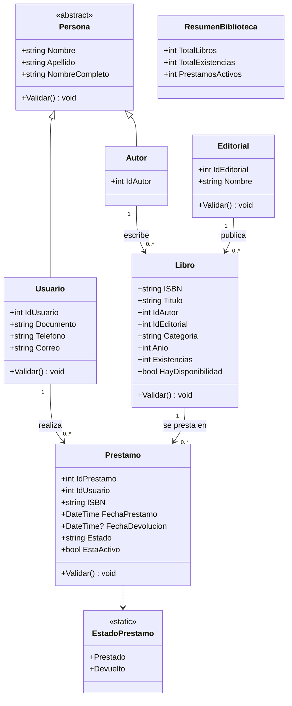

### Capas (servicios, repositorios y formularios)

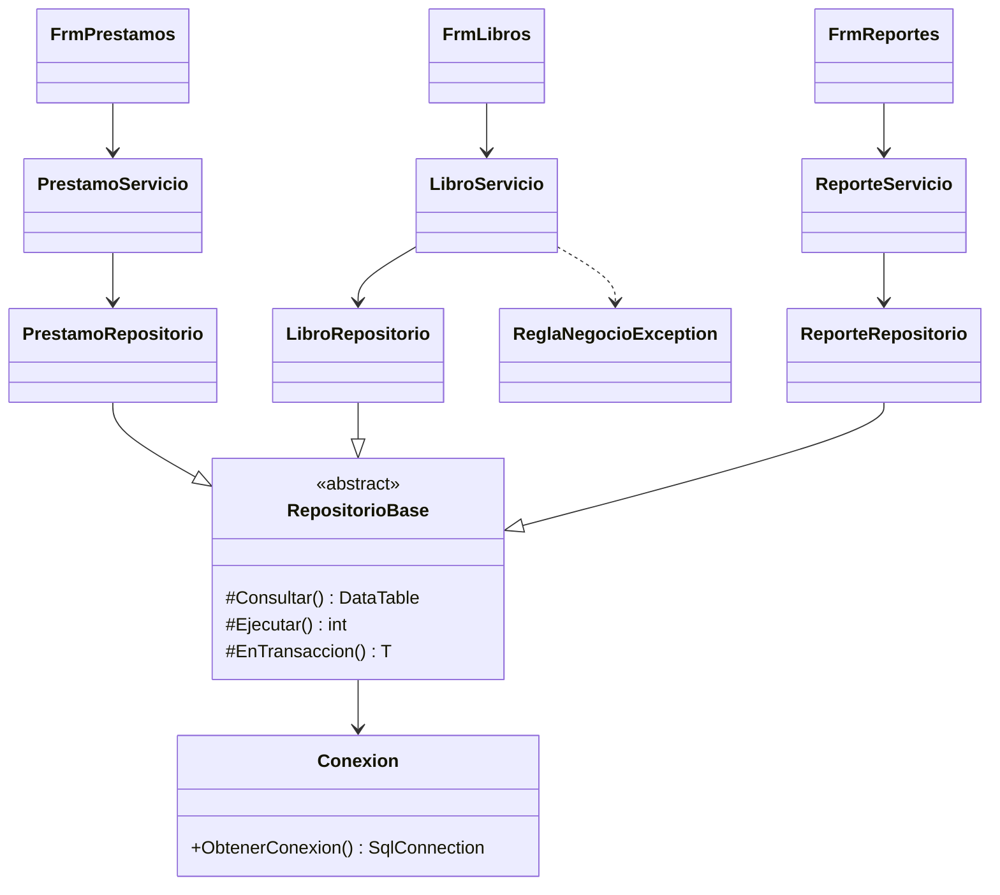

> Por claridad se muestran los módulos de Libros, Préstamos y Reportes. Autores, Editoriales y Usuarios siguen exactamente la misma estructura (`FrmAutores → AutorServicio → AutorRepositorio`, etc.).

## 6.3 Principales clases

| Clase | Capa | Responsabilidad |
|---|---|---|
| `Persona` | Modelos | Clase base abstracta con nombre, apellido y su validación. |
| `Autor` | Modelos | Representa a un autor (hereda de `Persona`). |
| `Usuario` | Modelos | Representa a un usuario de la biblioteca; valida documento, correo y teléfono. |
| `Editorial` | Modelos | Representa una editorial. |
| `Libro` | Modelos | Representa un libro con su autor, editorial, categoría, año y existencias. |
| `Prestamo` | Modelos | Representa un préstamo y valida la coherencia entre estado y fechas. |
| `EstadoPrestamo` | Modelos | Constantes de estado: `Prestado` y `Devuelto`. |
| `ResumenBiblioteca` | Modelos | Indicadores consolidados para el inicio y el reporte resumen. |
| `AutorServicio`, `EditorialServicio`, `UsuarioServicio`, `LibroServicio` | Negocio | Validan, verifican duplicados y relaciones, y coordinan el CRUD. |
| `PrestamoServicio` | Negocio | Reglas de préstamos y devoluciones. |
| `ReporteServicio` | Negocio | Catálogo de reportes y generación del resumen consolidado. |
| `Conexion` | Datos | Crea la conexión con SQL Server. |
| `RepositorioBase` | Datos | Ejecuta consultas parametrizadas y transacciones; traduce errores de integridad de SQL Server. |
| `*Repositorio` | Datos | Operaciones SQL de cada entidad y de los reportes. |
| `ReglaNegocioException` | Excepciones | Error con mensaje apto para el usuario cuando se incumple una regla. |
| `Validador`, `Mensajes`, `Grids`, `ExportadorCsv` | Utilidades | Validaciones reutilizables, cuadros de mensaje, formato de grillas y exportación a CSV. |
| `Frm*` | Presentación | Formularios Windows Forms de cada módulo. |

## 6.4 Aplicación de POO

- **Clases y objetos:** cada entidad del dominio es una clase (`Libro`, `Usuario`, `Prestamo`…), y los formularios trabajan con objetos de esas clases.
- **Constructores:** las entidades tienen constructor vacío y constructores con parámetros (por ejemplo, `new Usuario(nombre, apellido, documento, telefono, correo)`).
- **Encapsulamiento:** los campos privados (`_nombre`, `_documento`…) se exponen mediante propiedades que normalizan el texto (`Trim`) y convierten textos vacíos en `null` en los campos opcionales.
- **Propiedades y métodos:** propiedades calculadas (`NombreCompleto`, `EstaActivo`, `HayDisponibilidad`) y métodos `Validar()` en cada entidad.
- **Herencia:** `Autor` y `Usuario` heredan de la clase abstracta `Persona`, que centraliza nombre, apellido y su validación; los repositorios heredan de `RepositorioBase`.
- **Polimorfismo:** `Usuario` sobrescribe el método virtual `Validar()` de `Persona` para agregar las validaciones de documento, teléfono y correo.
- **Colecciones:** `List<ItemReporte>` para el catálogo de reportes y `DataTable` para los resultados de las consultas.
- **Organización de responsabilidades:** cada clase tiene una única responsabilidad dentro de su capa (presentar, validar/coordinar o acceder a datos).

---

# 7. MODELO ENTIDAD-RELACIÓN

## 7.1 Descripción

El modelo está normalizado hasta la **tercera forma normal** y se compone de cinco entidades: **Autores, Editoriales, Libros, Usuarios y Préstamos**. El análisis previo (requisitos, tabla sin normalizar, proceso de normalización y esquema lógico) se encuentra en la imagen del repositorio:


## 7.2 Diagrama entidad-relación

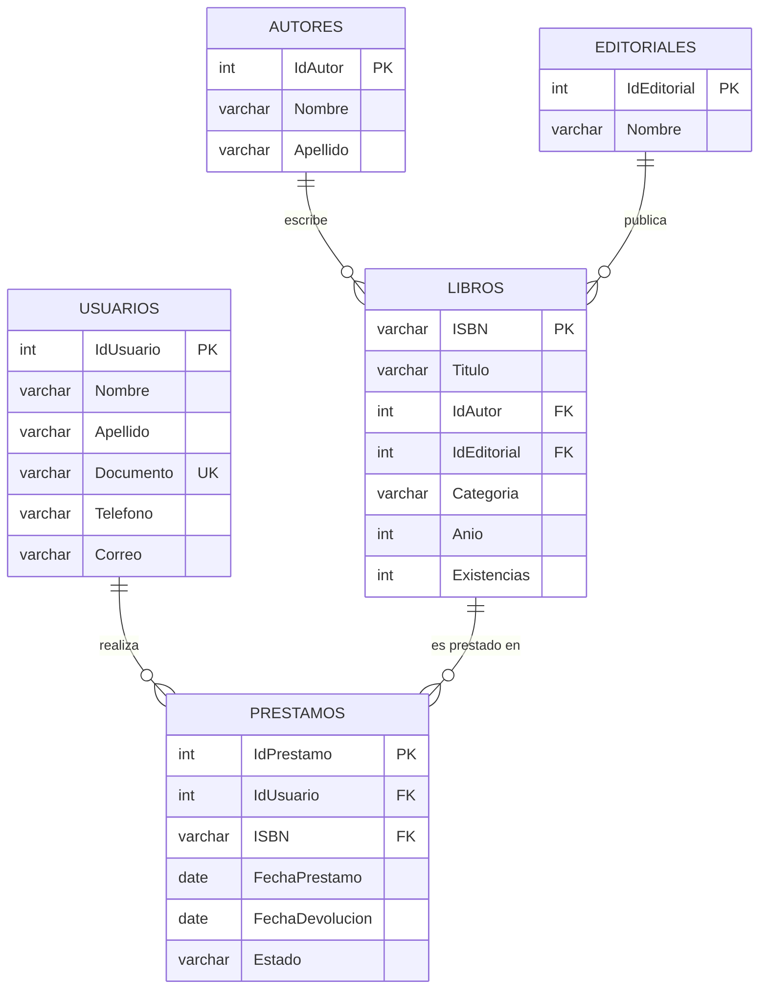

## 7.3 Relaciones principales

- Un **autor** puede tener muchos **libros**; cada libro tiene un único autor.
- Una **editorial** puede publicar muchos **libros**; cada libro pertenece a una editorial.
- Un **usuario** puede realizar muchos **préstamos**.
- Un **libro** puede ser prestado muchas veces (según sus existencias); cada préstamo corresponde a un único libro.

Cada préstamo relaciona un usuario con un libro, por lo que **no se requiere una tabla de detalle de préstamos** en el modelo implementado.

---

# 8. DICCIONARIO DE DATOS

## 8.1 Convenciones

| Abreviatura | Significado |
|---|---|
| PK | Clave primaria |
| FK | Clave foránea |
| UQ | Campo con valor único |
| CK | Restricción CHECK |
| NULL | Campo que puede estar vacío |
| NOT NULL | Campo obligatorio |

**Base de datos:** `AcaBiblioteca` (SQL Server). El script completo se encuentra en `Scripts/Script_AcaBiblioteca.sql`.

## 8.2 Tabla: Autores

| Campo | Tipo de dato | Clave | Nulo | Descripción |
|---|---|---|---|---|
| IdAutor | INT IDENTITY(1,1) | PK | No | Identificador único del autor. |
| Nombre | VARCHAR(100) | UQ (con Apellido) | No | Nombre del autor. |
| Apellido | VARCHAR(100) | UQ (con Nombre) | No | Apellido del autor. |

## 8.3 Tabla: Editoriales

| Campo | Tipo de dato | Clave | Nulo | Descripción |
|---|---|---|---|---|
| IdEditorial | INT IDENTITY(1,1) | PK | No | Identificador único de la editorial. |
| Nombre | VARCHAR(150) | UQ | No | Nombre de la editorial. |

## 8.4 Tabla: Libros

| Campo | Tipo de dato | Clave | Nulo | Descripción |
|---|---|---|---|---|
| ISBN | VARCHAR(20) | PK | No | Código único del libro. |
| Titulo | VARCHAR(200) | – | No | Título del libro. |
| IdAutor | INT | FK → Autores | No | Autor del libro. |
| IdEditorial | INT | FK → Editoriales | No | Editorial del libro. |
| Categoria | VARCHAR(100) | – | Sí | Categoría o género del libro (la aplicación la solicita como obligatoria). |
| Anio | INT | – | Sí | Año de publicación (la aplicación lo solicita como obligatorio). |
| Existencias | INT | CK (≥ 0) | No | Ejemplares disponibles para préstamo. |

## 8.5 Tabla: Usuarios

| Campo | Tipo de dato | Clave | Nulo | Descripción |
|---|---|---|---|---|
| IdUsuario | INT IDENTITY(1,1) | PK | No | Identificador único del usuario. |
| Nombre | VARCHAR(100) | – | No | Nombre del usuario. |
| Apellido | VARCHAR(100) | – | No | Apellido del usuario. |
| Documento | VARCHAR(30) | UQ | No | Número de documento de identidad. |
| Telefono | VARCHAR(30) | – | Sí | Teléfono de contacto. |
| Correo | VARCHAR(150) | – | Sí | Correo electrónico. |

## 8.6 Tabla: Prestamos

| Campo | Tipo de dato | Clave | Nulo | Descripción |
|---|---|---|---|---|
| IdPrestamo | INT IDENTITY(1,1) | PK | No | Identificador único del préstamo. |
| IdUsuario | INT | FK → Usuarios | No | Usuario que recibe el libro. |
| ISBN | VARCHAR(20) | FK → Libros | No | Libro prestado. |
| FechaPrestamo | DATE | – | No | Fecha en que se realizó el préstamo. |
| FechaDevolucion | DATE | CK | Sí | Fecha de devolución; vacía mientras esté prestado. Debe ser mayor o igual a la fecha de préstamo. |
| Estado | VARCHAR(20) | CK | No | `Prestado` o `Devuelto`. |

## 8.7 Restricciones de integridad

| Restricción | Tabla | Descripción |
|---|---|---|
| FK_Libros_Autores | Libros | `IdAutor` referencia a `Autores(IdAutor)`. |
| FK_Libros_Editoriales | Libros | `IdEditorial` referencia a `Editoriales(IdEditorial)`. |
| FK_Prestamos_Usuarios | Prestamos | `IdUsuario` referencia a `Usuarios(IdUsuario)`. |
| FK_Prestamos_Libros | Prestamos | `ISBN` referencia a `Libros(ISBN)`. |
| UQ_Autores_NombreApellido | Autores | Impide autores duplicados. |
| UQ_Editoriales_Nombre | Editoriales | Impide editoriales duplicadas. |
| (UNIQUE en columna) | Usuarios | `Documento` único. |
| CK_Libros_Existencias | Libros | `Existencias >= 0`. |
| CK_Prestamos_Estado | Prestamos | `Estado IN ('Prestado','Devuelto')`. |
| CK_Prestamos_Fechas | Prestamos | `FechaDevolucion` nula o mayor o igual a `FechaPrestamo`. |

---

# 9. ARQUITECTURA DEL SISTEMA

## 9.1 Descripción general

El sistema utiliza una **arquitectura por capas** para separar responsabilidades y facilitar el mantenimiento. Las capas están separadas por **carpetas y espacios de nombres** dentro de un mismo proyecto de Visual Studio (separación lógica):

1. Capa de Presentación.
2. Capa de Lógica de Negocio.
3. Capa de Acceso a Datos.
4. Capa de Base de Datos.

## 9.2 Diagrama de arquitectura

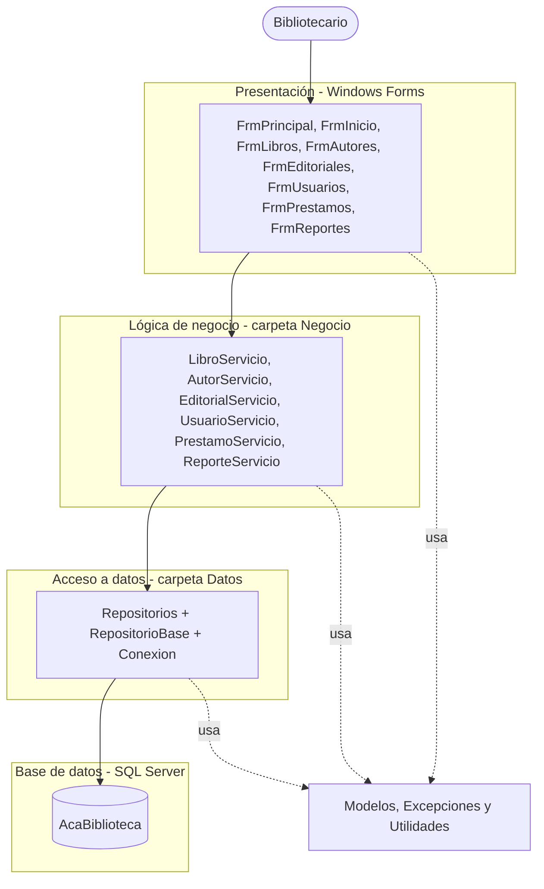

Estructura de carpetas del proyecto:

```text
AcaBiblioteca/
├── Frm*.cs              Presentación (Windows Forms)
├── Negocio/             Servicios con reglas y validaciones
├── Datos/               Conexion, RepositorioBase y repositorios
├── Modelos/             Entidades del dominio
├── Excepciones/         ReglaNegocioException
└── Utilidades/          Validador, Mensajes, Grids, ExportadorCsv
```

## 9.3 Capa de Presentación

**Responsabilidad:** interacción con el usuario: captura de datos, presentación de resultados y mensajes. No contiene SQL ni reglas de negocio.

**Componentes:** `FrmPrincipal` (menú y navegación), `FrmInicio`, `FrmLibros`, `FrmAutores`, `FrmEditoriales`, `FrmUsuarios`, `FrmPrestamos`, `FrmReportes`.

**Tecnología utilizada:** C#, Windows Forms, .NET 10 (`net10.0-windows`) y la librería FontAwesome.Sharp para los íconos del menú.

## 9.4 Capa de Lógica de Negocio

**Responsabilidad:** valida las operaciones, aplica las reglas del sistema y coordina el acceso a datos.

**Componentes:** `LibroServicio`, `AutorServicio`, `EditorialServicio`, `UsuarioServicio`, `PrestamoServicio`, `ReporteServicio`.

**Ejemplos de reglas implementadas:**

- Validar campos obligatorios, longitudes y formatos (mediante `Validar()` de las entidades y `Validador`).
- Impedir duplicados (ISBN, documento, autor, editorial).
- Verificar que el autor, la editorial, el usuario y el libro existan.
- Validar disponibilidad antes de prestar y que el usuario no tenga el libro activo.
- Impedir eliminar registros relacionados, indicando la cantidad de dependencias.
- Validar fechas de préstamo y devolución.

## 9.5 Capa de Acceso a Datos

**Responsabilidad:** gestionar la comunicación con SQL Server.

**Componentes:** `Conexion`, `RepositorioBase`, `AutorRepositorio`, `EditorialRepositorio`, `LibroRepositorio`, `UsuarioRepositorio`, `PrestamoRepositorio`, `ReporteRepositorio`.

**Tecnologías utilizadas:** SQL Server, ADO.NET con `Microsoft.Data.SqlClient` (versión 7.1.1) y consultas parametrizadas.

`RepositorioBase` ofrece los métodos `Consultar`, `Ejecutar`, `Escalar` y `EnTransaccion`, y traduce los errores de integridad de SQL Server (llave foránea y unicidad) a `ReglaNegocioException` con mensajes comprensibles.

## 9.6 Capa de Base de Datos

**Base de datos:** `AcaBiblioteca`

**Tablas:** `Autores`, `Editoriales`, `Libros`, `Usuarios`, `Prestamos` (ver sección 8).

## 9.7 Descripción de la conexión con SQL Server

La conexión se define en la clase `Conexion` (carpeta `Datos`), que entrega un objeto `SqlConnection` configurado con la siguiente cadena de conexión:

```text
Server=.\SQL2022;Database=AcaBiblioteca;Integrated Security=true;TrustServerCertificate=true;
```

- **Server:** instancia local `SQL2022` de SQL Server.
- **Database:** base de datos `AcaBiblioteca`.
- **Integrated Security:** autenticación de Windows (no se almacenan usuario ni contraseña en el código).

Cada operación abre su propia conexión dentro de un bloque `using`, por lo que se cierra y libera automáticamente. Para ejecutar el sistema en otro equipo basta con ajustar el nombre del servidor en esta cadena.

**Consultas parametrizadas.** Ningún valor ingresado por el usuario se concatena en el SQL; siempre se envía como parámetro. Ejemplo de `LibroRepositorio`:

```csharp
Consultar(@"SELECT ... FROM Libros L ...
            WHERE L.ISBN LIKE @Patron OR L.Titulo LIKE @Patron ...",
          Param("@Patron", patron));
```

**Transacciones.** Las operaciones de préstamo actualizan el préstamo y las existencias del libro de forma atómica. Si cualquier paso falla se revierte toda la operación:

```csharp
public int Registrar(Prestamo p)
{
    return EnTransaccion((cn, tx) =>
    {
        AjustarExistencias(cn, tx, p.ISBN, -1);   // descuenta una existencia
        // INSERT INTO Prestamos ... OUTPUT INSERTED.IdPrestamo
    });
}
```

## 9.8 Flujo de información

```text
Usuario
   ↓
Presentación (Frm*)
   ↓
Lógica de Negocio (*Servicio)
   ↓
Acceso a Datos (*Repositorio)
   ↓
SQL Server
```

Las respuestas de la base de datos realizan el recorrido inverso hasta llegar nuevamente a la interfaz. Las reglas incumplidas se propagan como `ReglaNegocioException` y se muestran al usuario como advertencia; los demás errores se muestran como error técnico.

---

# 10. EXPLICACIÓN DE CADA MÓDULO DESARROLLADO

## 10.1 Módulo de inicio

**Objetivo:** presentar la pantalla principal y los indicadores de la biblioteca.

**Funcionalidades:** tarjetas con el total de libros, ejemplares disponibles, préstamos activos, usuarios, autores y editoriales. También verifica la conexión con la base de datos al abrir la aplicación y avisa si falla.

## 10.2 Módulo de libros

**Objetivo:** administrar la información bibliográfica y sus relaciones con autores y editoriales.

**Funcionalidades:**
- Registrar, consultar, editar y eliminar libros.
- Seleccionar autor y editorial desde listas desplegables.
- Buscar por ISBN, título o autor (si hay un único resultado, se carga en el formulario).
- Consultar existencias en la tabla.

**Validaciones:**
- ISBN obligatorio, máximo 20 caracteres, solo letras, números y guiones; no se permiten ISBN repetidos.
- Título (máx. 200) y categoría (máx. 100) obligatorios.
- Autor y editorial seleccionados y existentes.
- Año numérico entre 1 y el año actual; existencias numéricas y no negativas.
- El ISBN no se puede modificar al editar.
- No se elimina un libro con préstamos.

## 10.3 Módulo de autores

**Objetivo:** administrar los autores de los libros.

**Funcionalidades:** registrar, consultar, editar y eliminar autores.

**Validaciones:** nombre y apellido obligatorios (máx. 100); no se permiten autores con el mismo nombre y apellido; no se elimina un autor con libros asociados.

## 10.4 Módulo de editoriales

**Objetivo:** administrar las editoriales.

**Funcionalidades:** registrar, consultar, editar y eliminar editoriales.

**Validaciones:** nombre obligatorio (máx. 150) y único; no se elimina una editorial con libros asociados.

## 10.5 Módulo de usuarios

**Objetivo:** administrar los usuarios de la biblioteca.

**Funcionalidades:** registrar, consultar, editar y eliminar usuarios.

**Validaciones:** nombre, apellido y documento obligatorios; documento único y alfanumérico; correo con formato válido y teléfono con formato válido cuando se ingresan (son opcionales); no se elimina un usuario con préstamos.

## 10.6 Módulo de préstamos

**Objetivo:** gestionar el ciclo de préstamo y devolución de libros.

**Funcionalidades:**
- **Registrar préstamo:** selecciona usuario, libro y fecha; descuenta una existencia.
- **Editar:** cambia usuario, libro o fecha de un préstamo activo (ajustando existencias si cambia el libro).
- **Registrar devolución:** define la fecha de devolución, cambia el estado a «Devuelto» y reintegra la existencia.
- **Eliminar:** elimina el préstamo; si estaba activo, reintegra la existencia.
- **Filtrar** la tabla por estado: Todos, Prestado o Devuelto.

Los botones se habilitan según el contexto: por ejemplo, un préstamo devuelto no puede editarse ni devolverse de nuevo.

## 10.7 Módulo de reportes

**Reportes implementados:**

| N.º | Reporte | Contenido |
|---|---|---|
| 1 | Resumen consolidado | Totales de libros, ejemplares, autores, editoriales, usuarios y préstamos (activos y devueltos). |
| 2 | Listado de libros registrados | ISBN, título, autor, editorial, categoría, año y existencias. |
| 3 | Libros con existencias disponibles | Libros con al menos un ejemplar disponible. |
| 4 | Libros más prestados | Total de préstamos por libro, de mayor a menor. |
| 5 | Listado de autores | Autores y cantidad de libros registrados. |
| 6 | Listado de editoriales | Editoriales y cantidad de libros registrados. |
| 7 | Listado de usuarios registrados | Datos del usuario y cantidad de préstamos activos. |
| 8 | Relación de préstamos registrados | Todos los préstamos con usuario, libro, fechas y estado. |
| 9 | Préstamos activos | Préstamos en estado «Prestado». |
| 10 | Préstamos devueltos | Préstamos en estado «Devuelto». |
| 11 | Historial de préstamos por usuario | Préstamos de un usuario, con los días de préstamo. |

Cualquier reporte generado puede **exportarse a CSV** (codificación UTF-8, compatible con Excel).

---

# 11. CAPTURAS DE PANTALLA DEL SISTEMA

> **Instrucciones:** las capturas de las interfaces se encuentran en la carpeta `Interfaces/` del repositorio.

## 11.1 Menú principal e inicio

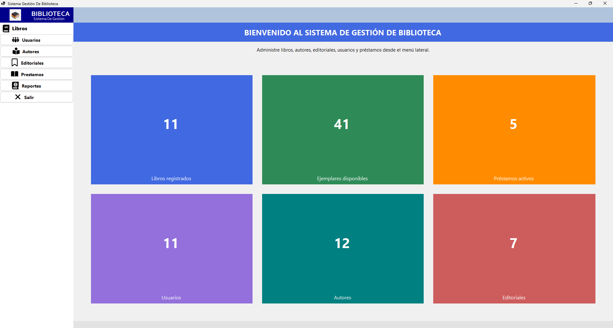

**Descripción:** formulario principal con el menú lateral de navegación y las tarjetas con los indicadores de la biblioteca.

## 11.2 Gestión de libros

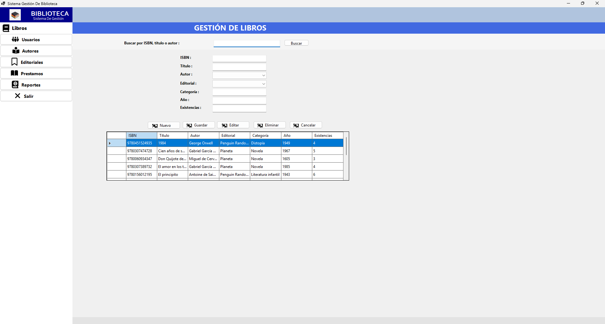

**Descripción:** formulario de libros con los campos de captura, las listas de autor y editorial, la búsqueda por ISBN, título o autor, y la tabla de libros con sus existencias.

## 11.3 Gestión de autores

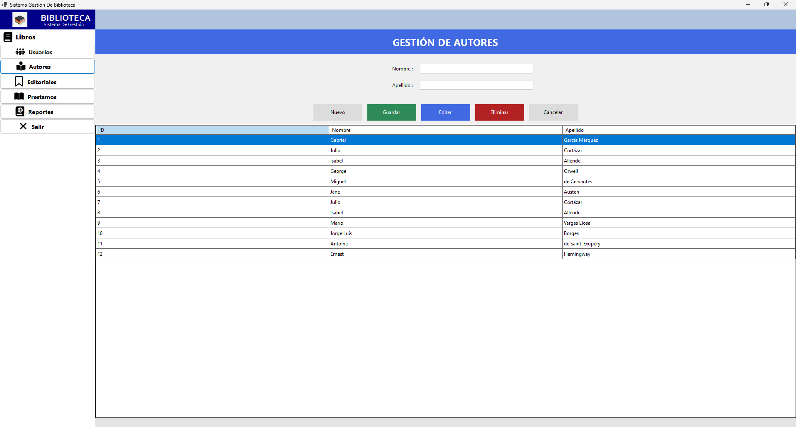

**Descripción:** registro, consulta, edición y eliminación de autores.

## 11.4 Gestión de editoriales

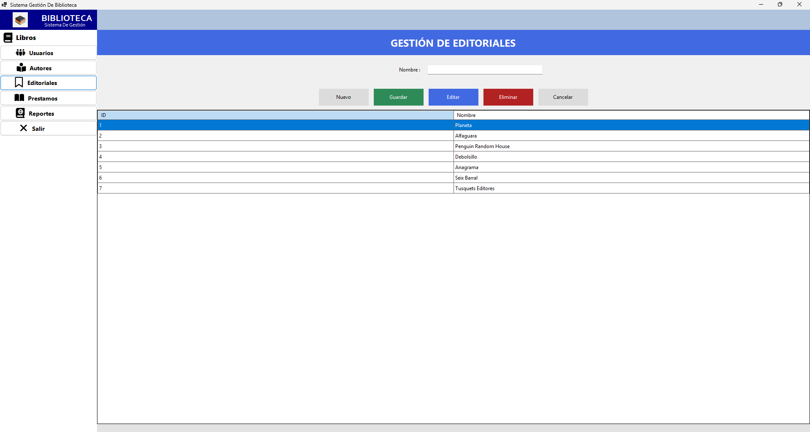

**Descripción:** registro, consulta, edición y eliminación de editoriales.

## 11.5 Gestión de usuarios

**Descripción:** administración de los usuarios con documento, teléfono y correo.

## 11.6 Registro de préstamos y devoluciones

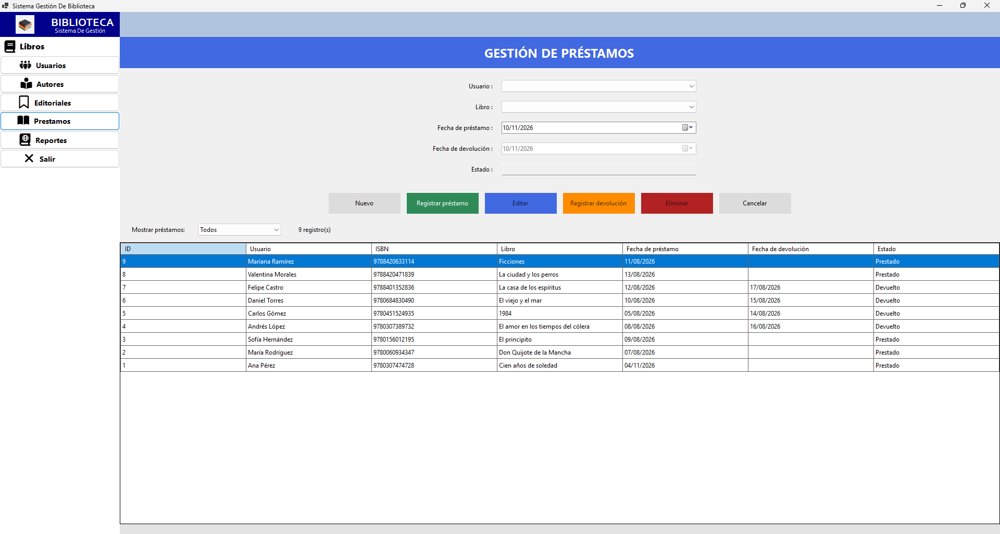

**Descripción:** selección de usuario y libro, fechas, estado, botones de registrar, editar, devolver y eliminar, y tabla filtrable por estado.

## 11.7 Reportes

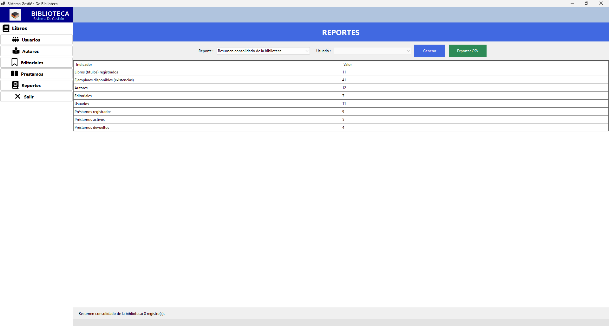

**Descripción:** selección y generación de reportes, resultados en tabla y exportación a CSV.

## 11.8 Mensajes de validación

**Descripción:** ejemplos de mensajes mostrados por el sistema ante datos inválidos, duplicados o restricciones de integridad.

---

# 12. PRUEBAS DE FUNCIONAMIENTO

## 12.1 Estrategia de pruebas

Se realizaron **pruebas funcionales manuales** de caja negra sobre cada módulo con la aplicación conectada a la base de datos `AcaBiblioteca` cargada con los datos de prueba del script SQL. Para cada caso se registra la acción, el resultado esperado y el resultado obtenido, cubriendo tanto los flujos correctos como las validaciones y reglas de integridad.

## 12.2 Casos de prueba

| ID | Funcionalidad | Entrada / Acción | Resultado esperado | Resultado obtenido | Estado |
|---|---|---|---|---|---|
| CP01 | Registrar libro | Datos válidos con ISBN nuevo | Libro registrado y visible en la tabla | _Completar_ | _Aprobado_ |
| CP02 | Registrar libro | ISBN ya existente | Mensaje «Ya existe un libro con ese ISBN» | _Completar_ | _Aprobado_ |
| CP03 | Registrar libro | Año con texto (por ejemplo, «abc») | Mensaje «El año debe ser un número entero» | _Completar_ | _Aprobado_ |
| CP04 | Buscar libro | Texto parcial de título o autor | La tabla muestra solo las coincidencias | _Completar_ | _Aprobado_ |
| CP05 | Registrar usuario | Datos válidos | Usuario registrado | _Completar_ | _Aprobado_ |
| CP06 | Registrar usuario | Documento repetido | Mensaje «Ya existe un usuario con ese documento» | _Completar_ | _Aprobado_ |
| CP07 | Registrar usuario | Correo sin formato válido (por ejemplo, «abc») | Mensaje de correo inválido | _Completar_ | _Aprobado_ |
| CP08 | Registrar autor | Campos vacíos | Mensaje de campo obligatorio | _Completar_ | _Aprobado_ |
| CP09 | Registrar editorial | Nombre ya existente | Mensaje «Ya existe una editorial con ese nombre» | _Completar_ | _Aprobado_ |
| CP10 | Eliminar autor | Autor con libros asociados | Se impide la eliminación indicando cuántos libros tiene | _Completar_ | _Aprobado_ |
| CP11 | Eliminar usuario | Usuario con préstamos | Se impide la eliminación indicando cuántos préstamos tiene | _Completar_ | _Aprobado_ |
| CP12 | Registrar préstamo | Usuario y libro con existencias | Préstamo «Prestado» y existencias disminuyen en 1 | _Completar_ | _Aprobado_ |
| CP13 | Registrar préstamo | Libro con 0 existencias | Mensaje «No hay existencias disponibles» | _Completar_ | _Aprobado_ |
| CP14 | Registrar préstamo | Mismo usuario y libro ya prestado sin devolver | Mensaje de préstamo activo existente | _Completar_ | _Aprobado_ |
| CP15 | Registrar devolución | Préstamo activo, fecha de hoy | Estado «Devuelto», fecha registrada y existencias aumentan en 1 | _Completar_ | _Aprobado_ |
| CP16 | Registrar devolución | Fecha anterior a la del préstamo | Mensaje de fecha inválida | _Completar_ | _Aprobado_ |
| CP17 | Editar préstamo | Préstamo ya devuelto | Botones de edición deshabilitados / no permitido | _Completar_ | _Aprobado_ |
| CP18 | Eliminar préstamo | Préstamo activo | Préstamo eliminado y existencia reintegrada | _Completar_ | _Aprobado_ |
| CP19 | Filtrar préstamos | Seleccionar «Prestado» y luego «Devuelto» | La tabla muestra solo los préstamos del estado elegido | _Completar_ | _Aprobado_ |
| CP20 | Reportes | Generar «Préstamos activos» | Tabla con los préstamos en estado Prestado | _Completar_ | _Aprobado_ |
| CP21 | Reportes | Historial por usuario sin elegir usuario | Mensaje para seleccionar un usuario | _Completar_ | _Aprobado_ |
| CP22 | Exportar reporte | Generar un reporte y pulsar «Exportar CSV» | Archivo CSV creado y abrible en Excel | _Completar_ | _Aprobado_ |


# 13. CONCLUSIONES

## Conclusión 1

Se desarrolló una aplicación de escritorio funcional para la gestión de una biblioteca que integra los módulos de libros, autores, editoriales, usuarios, préstamos, devoluciones y reportes, cumpliendo el alcance definido para el proyecto.

## Conclusión 2

La Programación Orientada a Objetos permitió modelar el dominio con clases cohesivas: constructores y propiedades con encapsulamiento, una clase base abstracta (`Persona`) especializada por `Autor` y `Usuario`, y polimorfismo mediante la sobrescritura de `Validar()`.

## Conclusión 3

El diseño relacional normalizado, con claves foráneas, restricciones UNIQUE y CHECK, y el uso de transacciones en las operaciones de préstamo, garantizó la integridad de los datos y la coherencia entre los préstamos y las existencias. La arquitectura por capas separó la interfaz, las reglas de negocio y el acceso a datos, lo que facilitó extender el sistema y reutilizar código (por ejemplo, `RepositorioBase` y `Validador`).

## Conclusión 4

Durante el desarrollo se identificó que la lógica y las consultas SQL estaban mezcladas con los formularios en los primeros módulos; se resolvió refactorizando hacia las capas de Negocio y Datos. También se detectaron datos de prueba inconsistentes (autores duplicados y un préstamo con un usuario inexistente), que se corrigieron en el script final y se previnieron en la aplicación mediante validaciones de duplicados y de existencia.

---

# 14. RECOMENDACIONES

- **Mejoras futuras:** incorporar multas por retraso, fecha límite de devolución y préstamos de varios libros mediante una tabla de detalle de préstamos.
- **Seguridad:** agregar inicio de sesión y roles (administrador y bibliotecario), y mover la cadena de conexión a un archivo de configuración fuera del código fuente.
- **Mantenimiento:** separar las capas en proyectos independientes (por ejemplo, bibliotecas de clases) y agregar pruebas unitarias automatizadas para la capa de negocio.
- **Nuevas funcionalidades:** exportar reportes a PDF o Excel, gestionar la categoría como entidad independiente, permitir varios autores por libro y registrar copias físicas individuales de cada libro.
- **Respaldo:** programar copias de seguridad periódicas de la base de datos.

---

# 15. REFERENCIAS BIBLIOGRÁFICAS

> Incluya únicamente las fuentes que realmente consultó y verifique que los enlaces estén vigentes.

Chacon, S., & Straub, B. (2014). *Pro Git* (2.ª ed.). Apress. https://git-scm.com/book/es/v2

Microsoft. (s. f.). *Documentación de Windows Forms*. Microsoft Learn. https://learn.microsoft.com/es-es/dotnet/desktop/winforms/

Microsoft. (s. f.). *Microsoft.Data.SqlClient namespace*. Microsoft Learn. https://learn.microsoft.com/es-es/dotnet/api/microsoft.data.sqlclient

Microsoft. (s. f.). *Documentación de SQL Server*. Microsoft Learn. https://learn.microsoft.com/es-es/sql/sql-server/

Microsoft. (s. f.). *Guía de C#*. Microsoft Learn. https://learn.microsoft.com/es-es/dotnet/csharp/

---

# ANEXOS

## Anexo A. Repositorio GitHub

**Repositorio:** (https://github.com/HernanVasquezDev/AcaBibliotecaUniversitaria.git)

## Anexo B. Script de base de datos

**Archivo:** `Scripts/Script_AcaBiblioteca.sql`

Contiene la creación de la base de datos, tablas, claves primarias y foráneas, restricciones de integridad y datos de prueba.

## Anexo C. Evidencia de Git y GitHub

Insertar capturas que evidencien:

-   Creación del repositorio.
  (evidencias/Evidencias_Repo_GitHub.png)
-   Commits realizados.
  (evidencias/Evidencias_Commits.png)
-   Organización del proyecto.
  (evidencias/Evidencias_Repo_GitHub.png)
-   Publicación del código.
  - (evidencias/Evidencias_Repo_GitHub.png)
-   README.md.
  - (evidencias/Evidencias_README.png)

## Anexo D. Instrucciones de ejecución

1. Instalar SQL Server y Visual Studio con la carga de trabajo *Desarrollo de escritorio con .NET*.
2. Ejecutar `Scripts/Script_AcaBiblioteca.sql` en SQL Server Management Studio.
3. Ajustar la cadena de conexión en `Datos/Conexion.cs` si el nombre de la instancia es diferente.
4. Abrir `AcaBiblioteca.slnx`, restaurar los paquetes NuGet (`Microsoft.Data.SqlClient` y `FontAwesome.Sharp`) y ejecutar la aplicación.

---

# LISTA DE VERIFICACIÓN ANTES DE ENTREGAR

- [x] Portada.
- [x] Contraportada (falta el grupo).
- [x] Introducción.
- [x] Objetivos.
- [x] Tabla de contenido.
- [x] Numeración de páginas (se genera al exportar a PDF/Word).
- [x] Planteamiento del problema.
- [x] Análisis de requerimientos.
- [x] Casos de uso.
- [x] Diagrama de casos de uso.
- [x] Diagrama de clases.
- [x] Modelo entidad-relación.
- [x] Diccionario de datos.
- [x] Arquitectura del sistema.
- [x] Descripción de la conexión con SQL Server.
- [x] Explicación de cada módulo.
- [x] Capturas de pantalla.
- [x]Pruebas de funcionamiento ejecutadas (completar resultados).
- [x] Conclusiones.
- [x] Recomendaciones.
- [x] Referencias bibliográficas en formato APA.
- [x] Código fuente completo.
- [x] Script SQL.
- [x] Datos de prueba.
- [x] Repositorio GitHub publicado.
- [x] README.md.
- [x] Evidencia de commits.
