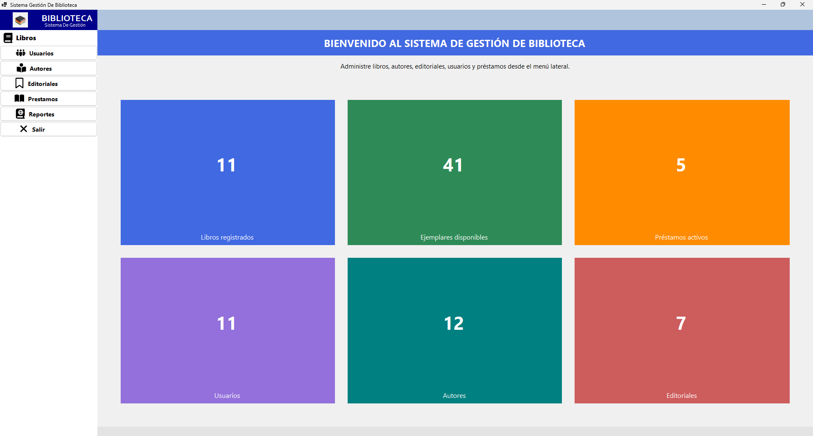
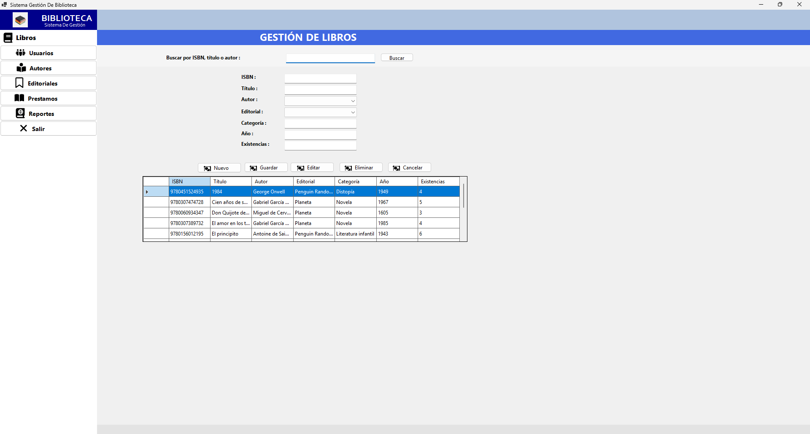
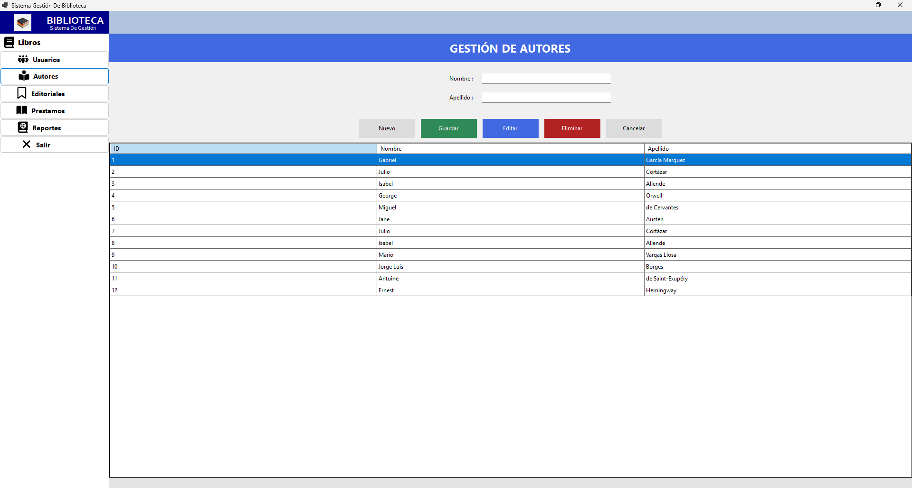
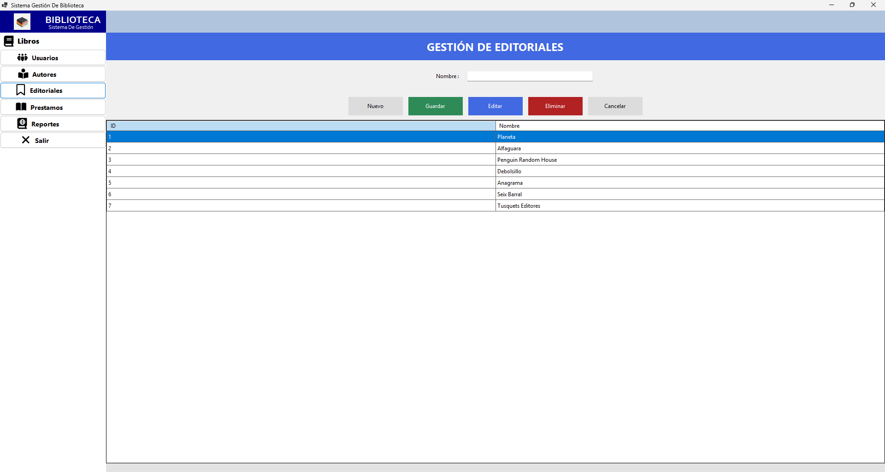
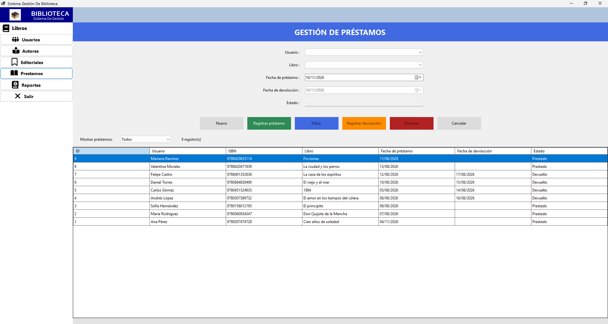
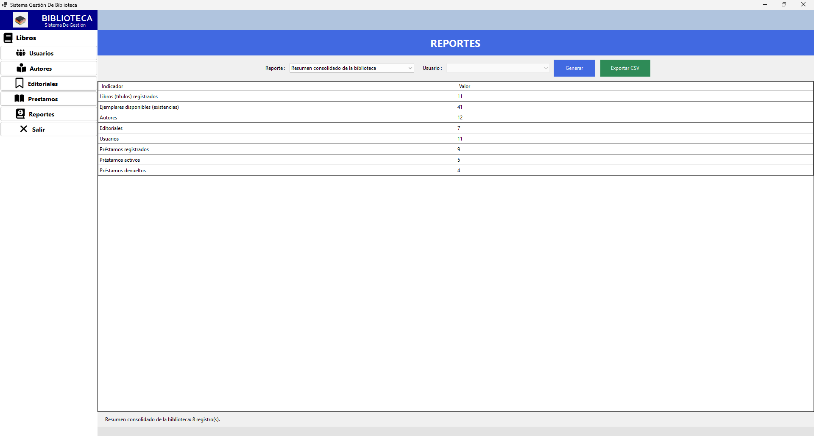

# Sistema de Gestión de Biblioteca

Aplicación de escritorio para administrar el catálogo de una biblioteca, sus usuarios y el proceso de préstamos y devoluciones. El proyecto fue desarrollado en C# con Windows Forms, .NET 10 y SQL Server, aplicando una arquitectura por capas y operaciones CRUD.

## Funcionalidades

- Gestión de libros, autores y editoriales.
- Registro, consulta, edición y eliminación de usuarios.
- Búsqueda de libros por ISBN, título o autor.
- Control de existencias disponibles.
- Registro, edición y eliminación de préstamos.
- Registro de devoluciones y actualización automática de existencias.
- Validación de datos y reglas de negocio.
- Prevención de préstamos duplicados para un mismo usuario y libro.
- Consulta de préstamos activos, devueltos e historial por usuario.
- Generación de reportes de libros, autores, editoriales, usuarios y préstamos.
- Exportación de reportes a archivos CSV.
- Mensajes de error comprensibles mediante excepciones de reglas de negocio.

## Tecnologías utilizadas

- **Lenguaje:** C#
- **Framework:** .NET 10 para Windows
- **Interfaz:** Windows Forms
- **Base de datos:** Microsoft SQL Server
- **Acceso a datos:** ADO.NET con `Microsoft.Data.SqlClient`
- **Iconos:** FontAwesome.Sharp
- **Control de versiones:** Git y GitHub

## Requisitos

Antes de ejecutar el proyecto se necesita:

- Windows.
- Visual Studio 2026 o una versión compatible con .NET 10.
- SDK de .NET 10.
- SQL Server local o remoto.
- SQL Server Management Studio (recomendado para crear la base de datos).

## Instalación

1. Clona el repositorio:

   ```bash
   git clone https://github.com/HernanVasquezDev/AcaBibliotecaUniversitaria.git
   cd AcaBibliotecaUniversitaria
   ```

2. Abre `AcaBiblioteca/AcaBiblioteca.slnx` en Visual Studio.

3. Restaura los paquetes NuGet. Visual Studio normalmente lo realiza de forma automática al cargar la solución.

4. Configura la base de datos siguiendo los pasos de la sección siguiente.

5. Selecciona el proyecto `AcaBiblioteca` como proyecto de inicio y ejecuta la aplicación con `F5`.

## Configuración de la base de datos

La aplicación utiliza actualmente la siguiente cadena de conexión en `AcaBiblioteca/AcaBiblioteca/Datos/Conexion.cs`:

```text
Server=localhost;Database=AcaBiblioteca;Integrated Security=true;TrustServerCertificate=true;
```

Esta configuración supone que:

- SQL Server se ejecuta en el equipo local.
- La base de datos se llama `AcaBiblioteca`.
- La conexión utiliza autenticación integrada de Windows.

Para crear la base de datos:

1. Abre SQL Server Management Studio.
2. Conéctate a la instancia de SQL Server.
3. Abre el archivo [`Querys BD - AcaBiblioteca.txt`](Querys%20BD%20-%20AcaBiblioteca.txt).
4. Ejecuta el script para crear la base de datos, las tablas y los datos iniciales.
5. Si utilizas otra instancia, servidor o método de autenticación, modifica la cadena de conexión antes de ejecutar la aplicación.

El modelo de datos principal está compuesto por las tablas:

- `Autores`
- `Editoriales`
- `Libros`
- `Usuarios`
- `Prestamos`

Las tablas `Libros` y `Prestamos` utilizan relaciones con autores, editoriales y usuarios mediante claves foráneas. El ISBN identifica cada libro y el documento identifica de forma única a cada usuario.

## Arquitectura del proyecto

El código está organizado en capas para separar las responsabilidades:

```text
AcaBiblioteca/
├── Datos/
│   ├── Conexion.cs
│   ├── RepositorioBase.cs
│   └── *Repositorio.cs
├── Excepciones/
│   └── ReglaNegocioException.cs
├── Modelos/
│   ├── Autor.cs
│   ├── Editorial.cs
│   ├── Libro.cs
│   ├── Prestamo.cs
│   ├── Usuario.cs
│   └── ...
├── Negocio/
│   └── *Servicio.cs
├── Utilidades/
│   ├── ExportadorCsv.cs
│   ├── Grids.cs
│   ├── Mensajes.cs
│   └── Validador.cs
├── FrmPrincipal.cs
├── FrmInicio.cs
├── FrmLibros.cs
├── FrmAutores.cs
├── FrmEditoriales.cs
├── FrmUsuarios.cs
├── FrmPrestamos.cs
└── FrmReportes.cs
```

- **Presentación:** formularios Windows Forms y controles de interacción.
- **Negocio:** validaciones y reglas de la biblioteca.
- **Datos:** consultas parametrizadas, transacciones y comunicación con SQL Server.
- **Modelos:** entidades utilizadas por las diferentes capas.
- **Utilidades:** exportación CSV, configuración de tablas y mensajes.

Las operaciones que modifican el inventario se ejecutan mediante transacciones. Además, las consultas utilizan parámetros para evitar la concatenación directa de valores ingresados por el usuario.

## Uso básico

1. Inicia la aplicación desde el formulario principal.
2. Registra autores y editoriales.
3. Registra los libros asociándolos con un autor y una editorial.
4. Registra los usuarios de la biblioteca.
5. Crea un préstamo seleccionando un usuario y un libro con existencias disponibles.
6. Cuando el libro sea devuelto, selecciona el préstamo y registra la devolución.
7. Consulta el módulo de reportes para revisar el inventario y los préstamos.

El sistema no permite prestar libros sin existencias, crear préstamos activos duplicados ni registrar devoluciones con fechas incoherentes.

## Capturas de pantalla

Las capturas de las interfaces están disponibles en la carpeta [`Interfaces`](Interfaces/):

### Inicio



### Libros



### Autores



### Editoriales



### Préstamos



### Reportes



## Documentación adicional

La documentación académica completa se encuentra en [`Documentacion_ACA_Programacion_Avanzada_Biblioteca.md`](Documentacion_ACA_Programacion_Avanzada_Biblioteca.md). Incluye los objetivos, requerimientos, casos de uso, modelo de datos, arquitectura, descripción de módulos, pruebas y conclusiones.

También se incluyen en el repositorio:

- [`Análisis BD Biblioteca.png`](An%C3%A1lisis%20BD%20Biblioteca.png): análisis y modelo de la base de datos.
- [`Diagramas Documentación Biblioteca`](Diagramas%20Documentaci%C3%B3n%20Biblioteca/): diagramas del proyecto.
- [`evidencias`](evidencias/): evidencias de funcionamiento y pruebas.

## Estado del proyecto

El proyecto contiene los módulos principales de gestión de una biblioteca y está preparado para ejecutarse como una aplicación de escritorio conectada a SQL Server.

## Autores

- Hernan Jose Vasquez Araujo
- Juan Camilo Rodriguez Caro
- Maria Gabriela Julio Vasquez
- Sara Liney Garcia Camargo

## Licencia

Este proyecto fue desarrollado con fines académicos para el curso de Programación Avanzada.
